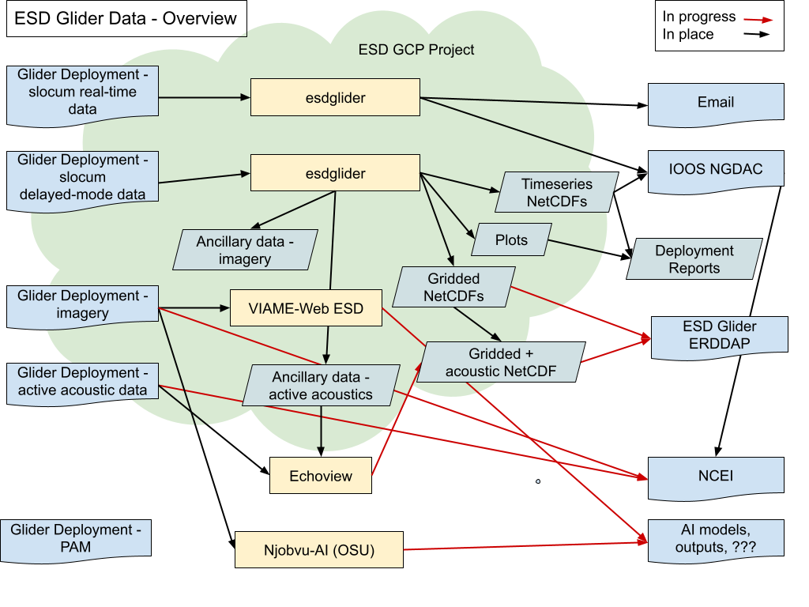

The below workflow provides an overview of ESD glider data inputs, processing, data products, and output locations. For more details about particular steps, see the individual data processing pages.

{fig-align="left" .black-outline}
